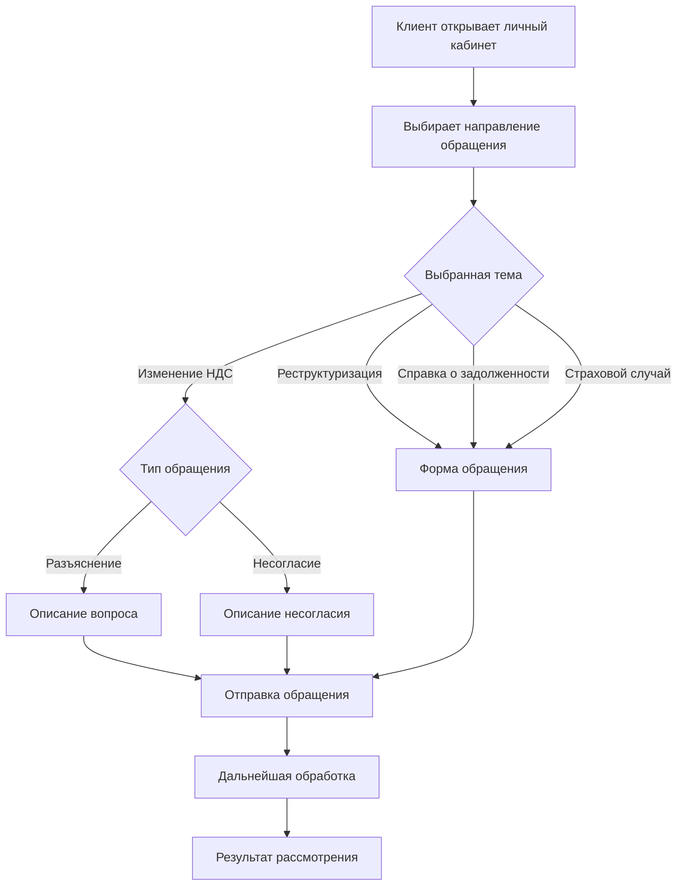
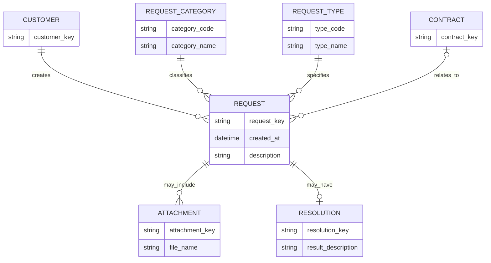
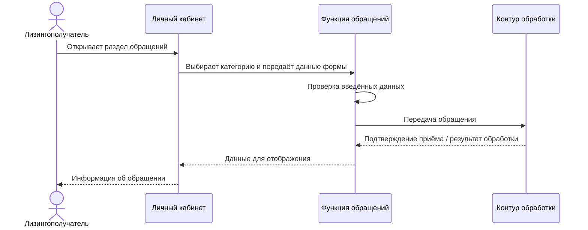

# Аналитическое описание фичи

> **Статус документа:** публичная концептуальная аналитическая проработка на основании сведений, доступных в обсуждении.  
> **Важно:** разделы «Архитектура», «База данных» и «Интеграции» не подтверждены исходной технической документацией. Диаграммы в этих разделах показывают логическую модель для обсуждения, а не фактическую архитектуру или реализованные интеграции.

# 1. Требования

## 1.1. Назначение

Функциональность предназначена для подачи обращений лизингополучателем через личный кабинет по вопросам обслуживания лизингового договора.

В рамках рассматриваемой фичи выделены четыре направления:
1. Реструктуризация.
2. Заказ справки о задолженности.
3. Страховые случаи.
4. Изменение НДС.

## 1.2. Бизнес-контекст

Тема изменения НДС связана с повышением ставки НДС до 22%. После повышения у клиентов возникли вопросы по графику платежей, а также обращения с несогласием относительно изменений.

Для темы НДС подтверждены два вида обращений:
- **Запрос на разъяснение** — клиент хочет понять влияние повышения НДС на договор, суммы платежей и график.
- **Обращение с несогласием** — клиент не согласен с изменением сумм платежей и/или графика и направляет обращение для рассмотрения.

## 1.3. Бизнес-требования

| ID | Требование | Статус |
|---|---|---|
| BR-01 | Предоставить клиенту возможность направить обращение через личный кабинет по предусмотренным направлениям | Подтверждено на уровне наличия фичи |
| BR-02 | Разделить обращения по тематическим направлениям: реструктуризация, справка о задолженности, страховые случаи, изменение НДС | Подтверждено |
| BR-03 | Для темы изменения НДС предусмотреть обработку запросов на разъяснение и обращений с несогласием | Подтверждено |
| BR-04 | Обеспечить рассмотрение обращения по существующему бизнес-процессу | Требует подтверждения; сам процесс не описан |
| BR-05 | Предоставить клиенту результат рассмотрения обращения | Требует подтверждения; канал и формат ответа неизвестны |

## 1.4. Функциональные требования

Ниже зафиксированы требования только на том уровне детализации, который поддерживается имеющейся информацией. Предполагаемые детали помечены отдельно.

| ID | Функциональное требование | Статус |
|---|---|---|
| FR-01 | Функциональность должна поддерживать четыре направления обращений | Подтверждено |
| FR-02 | Тема «Изменение НДС» должна различать запрос на разъяснение и обращение с несогласием | Подтверждено |
| FR-03 | Клиент должен иметь возможность изложить суть обращения | Логически необходимо для обращения; способ ввода и обязательность поля требуют подтверждения |
| FR-04 | Система должна передать зарегистрированное обращение на дальнейшее рассмотрение | Требует подтверждения фактического механизма и маршрута |
| FR-05 | Клиент должен получить информацию о результате рассмотрения | Требует подтверждения |

## 1.5. Пользовательские сценарии по направлениям

| Направление | Содержание обращения | Детализация |
|---|---|---|
| Реструктуризация | Обращение по вопросу реструктуризации | Условия, типы запросов и состав данных неизвестны |
| Справка о задолженности | Запрос справки о задолженности | Виды справок и параметры заказа неизвестны |
| Страховые случаи | Обращение по страховому случаю | Типы событий и список документов неизвестны |
| Изменение НДС — разъяснение | Вопрос о влиянии повышения НДС 22% на договор, платежи и график | Подтверждён тип обращения; поля формы неизвестны |
| Изменение НДС — несогласие | Несогласие с изменениями сумм платежей и/или графика | Подтверждён тип обращения; порядок проверки неизвестен |

## 1.6. Диаграмма пользовательского потока

Диаграмма показывает обобщённую последовательность подачи обращения. Конкретные экраны, проверки и статусы не подтверждены.

> Потоки после отправки и предоставления результата являются концептуальными: фактический маршрут, статусы и канал ответа необходимо уточнить.

## 1.7. Бизнес-ограничения

- Подача обращения по теме НДС сама по себе не означает автоматический перерасчёт платежей.
- Подача обращения не означает автоматическое изменение графика или условий договора.
- Нельзя считать, что обращение автоматически удовлетворяется.
- Сроки рассмотрения, ответственные подразделения и статусы не определены имеющимися сведениями.

# 2. Архитектура

## 2.1. Общая логическая схема

Фактическая архитектура решения не предоставлена. Ниже приведена **концептуальная схема компонентов**, необходимая для обсуждения границ функциональности.

## 2.2. Назначение логических компонентов

| Компонент | Предполагаемая ответственность | Статус |
|---|---|---|
| Личный кабинет | Пользовательский интерфейс клиента | Наличие личного кабинета подтверждено; внутреннее устройство неизвестно |
| Функция подачи обращений | Сбор данных и инициирование отправки обращения | Логическое выделение для описания фичи |
| Контур обработки обращений | Рассмотрение поступившего обращения | Наличие и устройство отдельного компонента не подтверждены |
| Представление результата | Отображение клиенту ответа или результата | Требует подтверждения |

## 2.3. Границы архитектурного описания

Не определены и не должны считаться фактом:
- используемые приложения, сервисы и платформы;
- физическое размещение компонентов;
- протоколы взаимодействия;
- синхронная или асинхронная модель обмена;
- механизмы авторизации и разграничения доступа;
- очереди, брокеры сообщений и фоновые задания;
- мониторинг, логирование и отказоустойчивость.

# 3. База данных

## 3.1. Назначение модели данных

Физическая схема базы данных и структура существующих таблиц не предоставлены. Для фиксации предметной области ниже приведена **предварительная логическая модель сущностей**, которые могут потребоваться для поддержки обращений.

Это не описание фактической БД, таблиц, колонок или связей в рабочей системе.

## 3.2. Логические сущности

| Сущность | Назначение | Примечание |
|---|---|---|
| Обращение (Request) | Хранение сведений об обращении клиента | Концептуальная сущность |
| Категория обращения (RequestCategory) | Классификация по четырём направлениям | Значения категорий основаны на подтверждённом перечне |
| Тип обращения (RequestType) | Уточнение типа обращения внутри категории | Для НДС подтверждены «разъяснение» и «несогласие» |
| Клиент (Customer) | Связь обращения с инициатором | Состав атрибутов неизвестен |
| Договор (Contract) | Возможная связь обращения с лизинговым договором | Не подтверждено, что договор выбирается в форме |
| Вложение (Attachment) | Возможное хранение приложенных файлов | Наличие и правила вложений неизвестны |
| Результат рассмотрения (Resolution) | Возможная фиксация результата | Структура и наличие сущности требуют подтверждения |

## 3.3. Концептуальная ER-диаграмма

> Имена сущностей и атрибутов условные. Идентификаторы приведены как логические ключи, а не как реальные поля или идентификаторы рабочей системы. Связь с договором, вложениями и результатом — проектные предположения.

## 3.4. Подтверждённые значения классификации

**Категории обращений:**
- Реструктуризация.
- Заказ справки о задолженности.
- Страховые случаи.
- Изменение НДС.

**Типы для категории «Изменение НДС»:**
- Запрос на разъяснение.
- Обращение с несогласием.

Для остальных категорий типизация не определена имеющимися сведениями.

## 3.5. Вопросы к модели данных

1. Используется ли идентификатор клиента из личного кабинета или отдельный ключ?
2. Должно ли обращение быть связано с конкретным договором?
3. Хранятся ли вложения в БД или во внешнем файловом хранилище?
4. Какие атрибуты обращения обязательны?
5. Фиксируется ли история изменения обращения?
6. Хранится ли ответ/результат в карточке обращения?
7. Как реализуются сроки хранения и удаление данных?

# 4. Интеграции

## 4.1. Общие сведения

Фактический перечень интеграций, системы-участники, протоколы и контракты не предоставлены. Поэтому в этом разделе не указываются названия внутренних систем, API, очередей или форматы сообщений.

На концептуальном уровне можно выделить взаимодействие личного кабинета с контуром, который принимает и обеспечивает дальнейшее рассмотрение обращения. Наличие отдельной системы или сервиса для этого требует подтверждения.

## 4.2. Концептуальная схема взаимодействия

> Диаграмма является целевой иллюстрацией возможного взаимодействия. Проверка данных, подтверждение приёма, обратный ответ и отдельный контур обработки требуют сверки с фактической реализацией. Диаграмма не является API-контрактом.

## 4.3. Данные, потенциально передаваемые при взаимодействии

| Группа данных | Содержание | Статус |
|---|---|---|
| Категория | Одно из четырёх направлений обращения | Категории подтверждены |
| Тип обращения | Разъяснение или несогласие для темы НДС | Подтверждено для НДС |
| Описание | Текст вопроса или сути несогласия | Логически ожидается; точный состав и обязательность неизвестны |
| Клиентский контекст | Данные для идентификации инициатора | Требует уточнения |
| Договорный контекст | Ссылка на договор, если применимо | Требует уточнения |
| Вложения | Файлы, подтверждающие обращение | Требует уточнения |

## 4.4. Интеграционные вопросы

- Как личный кабинет идентифицирует клиента?
- Откуда берётся список доступных договоров, если выбор договора предусмотрен?
- Куда фактически передаётся обращение?
- Как подтверждается успешная регистрация?
- Как обрабатываются ошибки передачи и повторные попытки?
- Как поступает ответ или статус рассмотрения?
- Используются ли файловые сервисы для вложений?
- Какие требования предъявляются к защите персональных и договорных данных?

## 4.5. Что необходимо для финализации

Для замены концептуальных схем фактическими нужны подтверждённые сведения:
- схема компонентов или описание систем-участников;
- фактический маршрут данных;
- спецификация интерфейсов или обезличенные контракты;
- логическая или физическая схема БД;
- правила обработки ошибок и повторной отправки.

В публичный репозиторий следует помещать только обезличенные схемы и примеры, не содержащие внутренних адресов, токенов, идентификаторов, персональных данных и конфиденциальных деталей.
