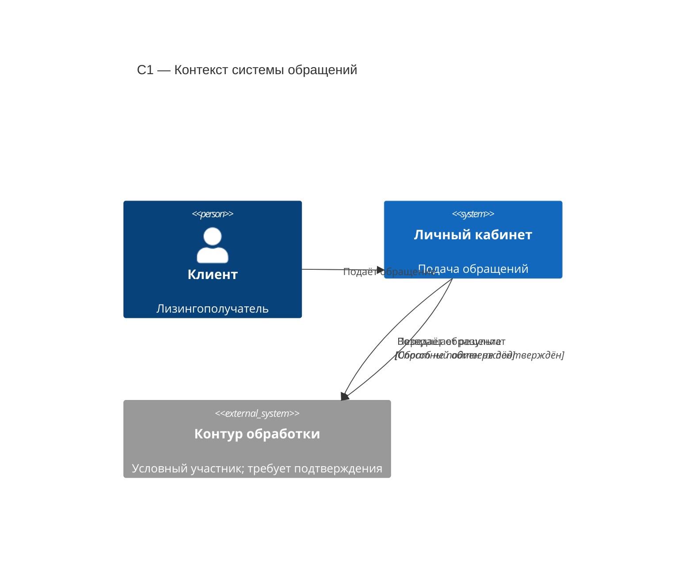
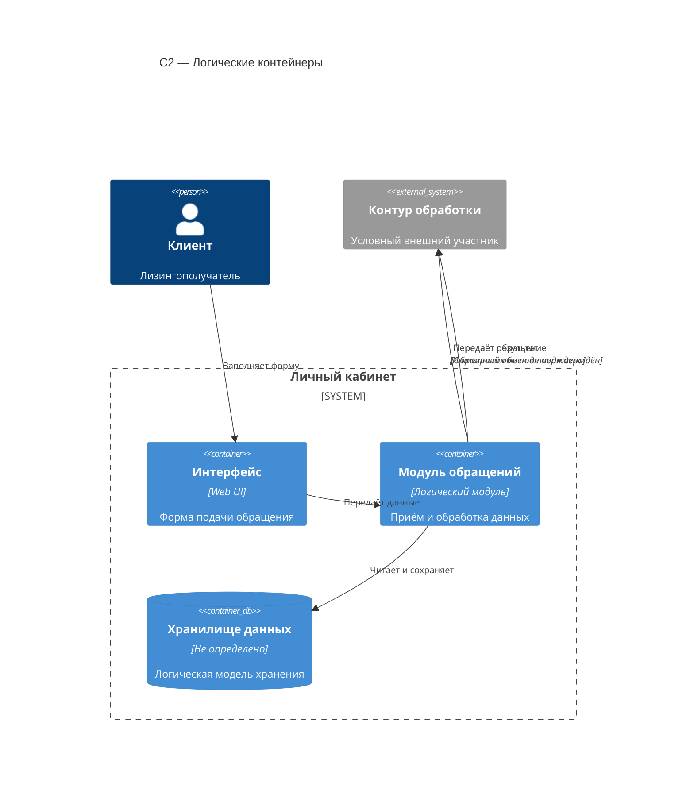
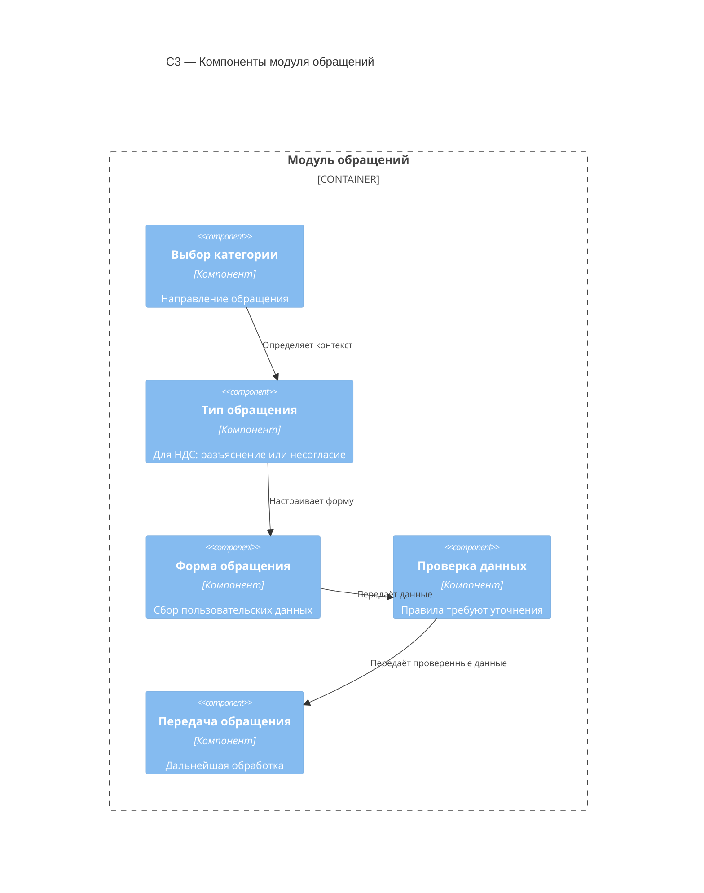

# C4-модель функциональности обращений

> **Статус:** концептуальная модель для публичного портфолио. Фактическая архитектура, состав сервисов, хранилище и интеграции не подтверждены. Диаграммы показывают аналитическую декомпозицию, а не утверждение о реализованном решении.

## Границы модели

Личный кабинет лизингополучателя позволяет подать обращения по четырём направлениям:

- реструктуризация;
- заказ справки о задолженности;
- страховые случаи;
- изменение НДС — запрос на разъяснение или обращение с несогласием.

Подача обращения по теме НДС не означает автоматического перерасчёта платежей или изменения графика.

## C1 — System Context

Показывает пользователя, рассматриваемую систему и условного участника дальнейшей обработки. Внешний участник и обмен с ним требуют подтверждения.

**Как читать:** клиент создаёт обращение в личном кабинете. Передача во внешний контур и получение результата показаны как возможные взаимодействия, а не как подтверждённая интеграция.

## C2 — Container

Показывает логические части личного кабинета. Обозначения Container и ContainerDb используются в нотации C4 и не означают, что в реализации существуют отдельные сервисы или конкретная СУБД.

**Как читать:** интерфейс передаёт пользовательский ввод модулю обращений. Хранилище и внешний контур показаны логически; их физическая реализация и способы взаимодействия неизвестны.

## C3 — Component

Условная декомпозиция логического модуля обращений. Компоненты описывают зоны ответственности, а не подтверждённые программные классы.

**Как читать:** пользователь выбирает направление и тип обращения, заполняет форму. Затем данные проходят проверки и передаются на дальнейшую обработку. Конкретные поля и правила проверок пока не определены.

## C4 — Code

Уровень Code описывает исходный код: классы, интерфейсы и зависимости. Он не приводится, поскольку исходный код и подтверждённый технологический стек не предоставлены.

## Вопросы для подтверждения архитектуры

1. Функциональность находится внутри личного кабинета или реализована отдельным сервисом?
2. Где фактически регистрируются и хранятся обращения?
3. Как устроена маршрутизация на дальнейшее рассмотрение?
4. Есть ли обратный обмен статусами и результатами?
5. Какие проверки выполняются на клиентской и серверной сторонах?
6. Где хранятся вложения, если они предусмотрены?
7. Какие механизмы защиты и журналирования используются?

## NDA и условные обозначения

- Названия систем и компонентов обобщены.
- Реальные URL, API-эндпоинты, идентификаторы и названия платформ не приводятся.
- Внешний контур, хранилище и связи, отмеченные как неподтверждённые, требуют валидации.
- Диаграммы не описывают автоматический перерасчёт НДС или изменение графика платежей.
