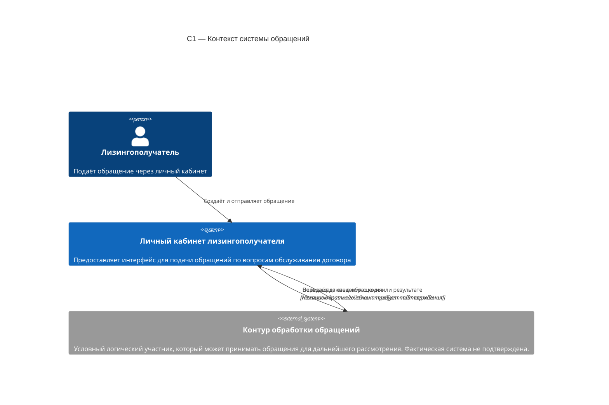
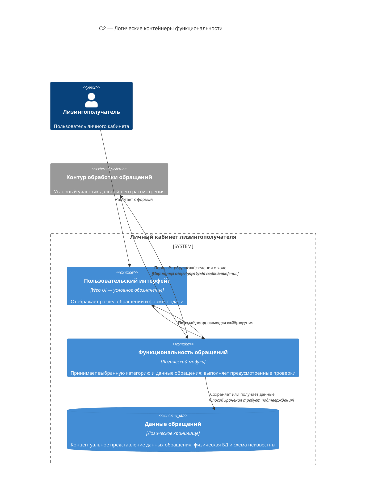
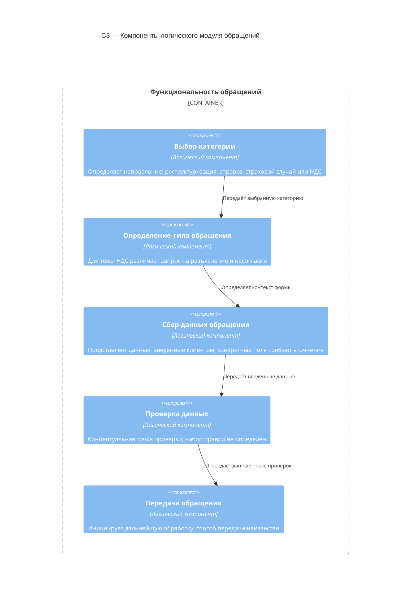

# C4-модель функциональности обращений

> **Статус:** концептуальная архитектурная модель для публичного портфолио. Фактическая архитектура, состав сервисов, хранилища и интеграции не предоставлены. Все технические блоки ниже — логические представления для обсуждения, а не подтверждение существующей реализации.

## Границы модели

Рассматриваемая система — личный кабинет лизингополучателя с функциональностью подачи обращений по четырём направлениям:
- реструктуризация;
- заказ справки о задолженности;
- страховые случаи;
- изменение НДС (запрос на разъяснение или обращение с несогласием).

Для темы НДС подтверждены два типа обращений. Подача обращения не означает автоматического перерасчёта платежей или изменения графика.

## C1 — System Context

Диаграмма показывает пользователя и систему в контексте предметной области. Отдельный контур обработки показан как условный внешний участник взаимодействия: его фактическое наличие и границы требуют подтверждения.

## C2 — Container

Диаграмма декомпозирует личный кабинет на логические части. Она не утверждает, что в рабочем решении существуют отдельные микросервисы или физически выделенные контейнеры.

## C3 — Component

На уровне компонентов функциональность обращений можно концептуально разделить на обработку категории, типа обращения и пользовательских данных. Это аналитическая декомпозиция, а не подтверждённая структура программного кода.

## C4 — Code

Уровень Code описывает классы, интерфейсы и зависимости на уровне исходного кода. Он не приводится, поскольку исходный код и подтверждённая технология реализации не предоставлены. Придумывать классы или программные интерфейсы означало бы выдавать гипотезы за фактическую реализацию.

## Архитектурные вопросы для подтверждения

1. Функциональность реализована внутри личного кабинета или вынесена в отдельный сервис?
2. Где фактически регистрируются и хранятся обращения?
3. Какой компонент отвечает за маршрутизацию и дальнейшее рассмотрение?
4. Есть ли обратный обмен статусами и результатами?
5. Какие проверки выполняются на клиентской и серверной сторонах?
6. Есть ли отдельное хранилище вложений?
7. Какие механизмы аутентификации, авторизации, журналирования и защиты данных используются?

## Условные обозначения и NDA

- Названия компонентов обобщены и не раскрывают внутренние названия систем.
- Не используются реальные URL, API-эндпоинты, идентификаторы и названия платформ.
- Блок «Контур обработки обращений» является условным и должен быть заменён подтверждённым участником процесса либо удалён.
- Диаграммы не описывают автоматический перерасчёт НДС или изменение графика платежей.
