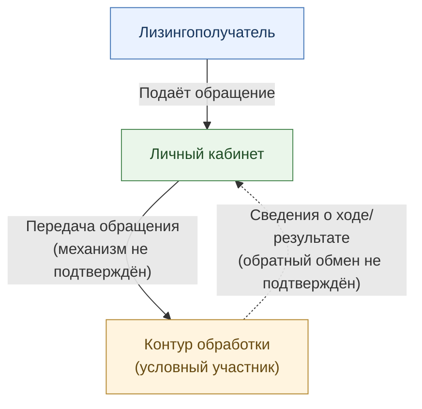
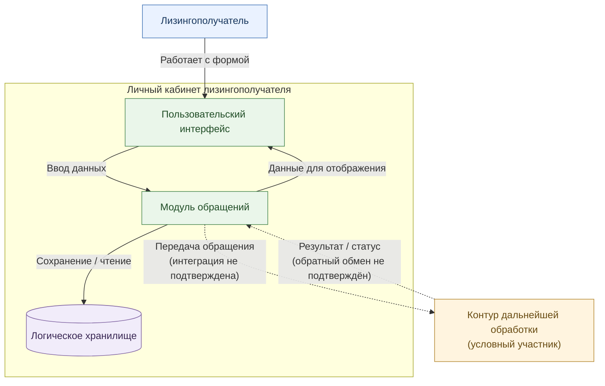
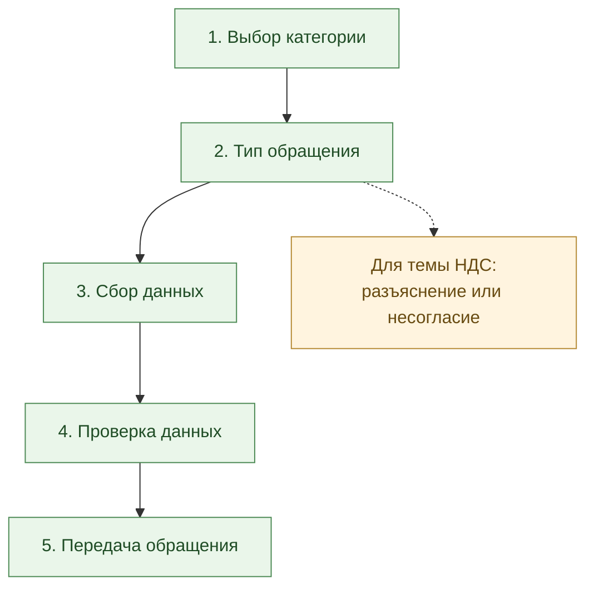

# C4-модель функциональности обращений

> **Статус:** концептуальная архитектурная модель для публичного портфолио. Фактическая архитектура, состав сервисов, хранилища и интеграции не предоставлены. Диаграммы показывают аналитическую модель, а не подтверждённую реализацию.

## Границы модели

Рассматривается личный кабинет лизингополучателя с функциональностью подачи обращений по четырём направлениям:

- реструктуризация;
- заказ справки о задолженности;
- страховые случаи;
- изменение НДС: запрос на разъяснение или обращение с несогласием.

Подача обращения по теме НДС сама по себе не означает автоматического перерасчёта платежей или изменения графика.

## C1 — System Context

Диаграмма упрощена: только основные участники и взаимодействия. Контур обработки — условный участник, его фактическое наличие и границы нужно подтвердить.

**Как читать:** клиент отправляет обращение через личный кабинет. Дальнейшая передача и возврат статуса показаны как возможный сценарий, который необходимо подтвердить.

## C2 — Container

Здесь показаны логические части функциональности. Это не утверждение о наличии отдельных микросервисов, приложений или физической базы данных.

**Как читать:** интерфейс принимает ввод клиента, модуль обращений обрабатывает данные и взаимодействует с логическим хранилищем. Внешняя передача показана пунктиром, поскольку интеграция не подтверждена.

## C3 — Component

Условная декомпозиция модуля обращений на аналитические компоненты. Названия описывают ответственность, но не подтверждают структуру исходного кода.

**Как читать:** пользователь выбирает категорию, указывает тип обращения (для НДС), заполняет форму, после чего данные проходят предусмотренные проверки и передаются на дальнейшую обработку. Состав полей и правила проверок пока не определены.

## C4 — Code

Уровень Code описывает классы, интерфейсы и зависимости исходного кода. Он не приводится: исходный код и подтверждённый технологический стек не предоставлены. Придумывать классы или программные интерфейсы означало бы выдавать гипотезы за фактическую реализацию.

## Архитектурные вопросы для подтверждения

1. Функциональность реализована внутри личного кабинета или вынесена в отдельный сервис?
2. Где фактически регистрируются и хранятся обращения?
3. Какой компонент отвечает за маршрутизацию и дальнейшее рассмотрение?
4. Есть ли обратный обмен статусами и результатами?
5. Какие проверки выполняются на клиентской и серверной сторонах?
6. Есть ли отдельное хранилище вложений?
7. Какие механизмы аутентификации, авторизации, журналирования и защиты данных используются?

## Условные обозначения и NDA

- Названия компонентов обобщены и не раскрывают внутренние названия систем.
- Реальные URL, API-эндпоинты, идентификаторы и названия платформ не используются.
- Пунктирные связи и блок «Контур обработки» обозначают неподтверждённые взаимодействия.
- Диаграммы не описывают автоматический перерасчёт НДС или изменение графика платежей.
