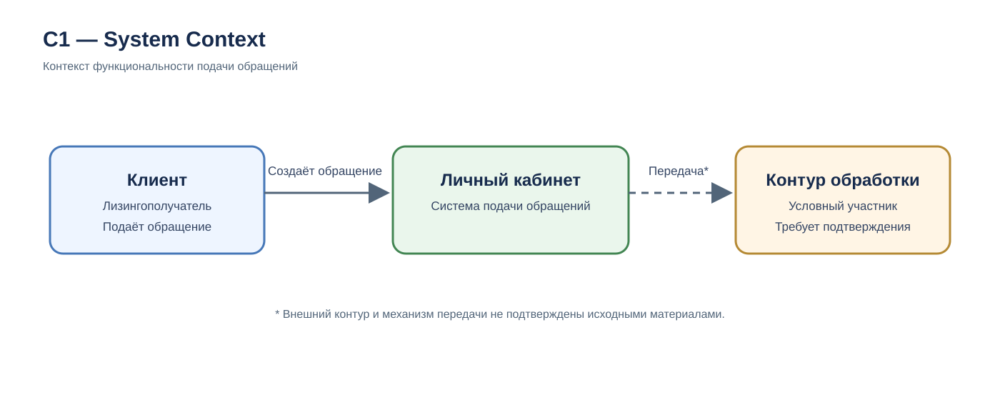
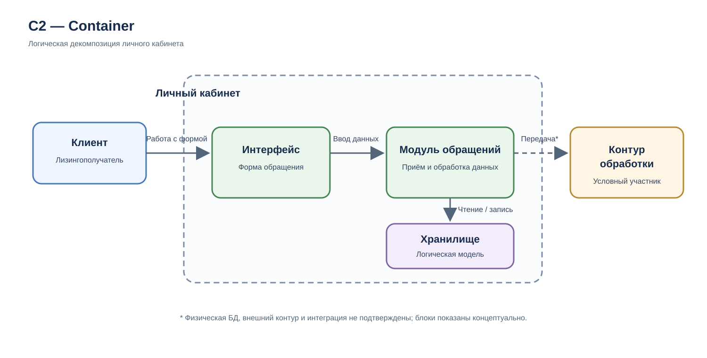
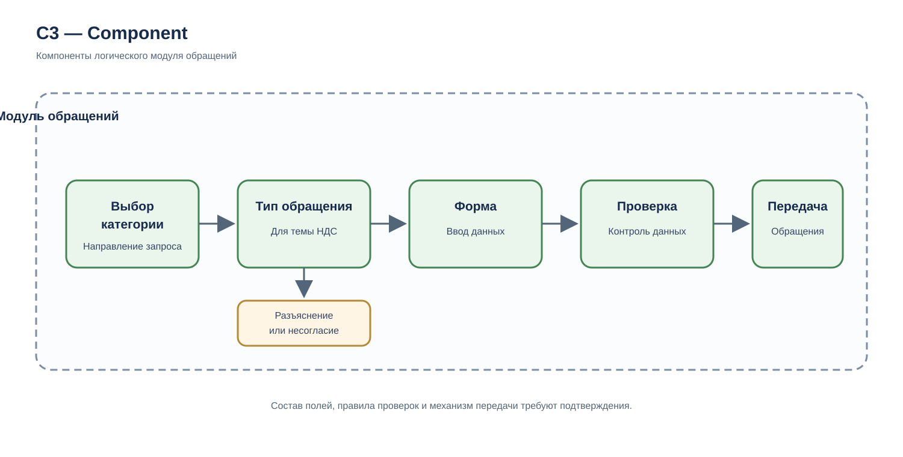

# C4-модель функциональности обращений

> **Статус:** концептуальная модель для публичного портфолио. Фактическая архитектура, состав сервисов, хранилище и интеграции не подтверждены. Диаграммы показывают аналитическую декомпозицию, а не утверждение о реализованном решении.

## Границы модели

Личный кабинет лизингополучателя позволяет подать обращения по четырём направлениям:

- реструктуризация;
- заказ справки о задолженности;
- страховые случаи;
- изменение НДС — запрос на разъяснение или обращение с несогласием.

Подача обращения по теме НДС не означает автоматического перерасчёта платежей или изменения графика.

## C1 — System Context

- Клиент — лизингополучатель, который подаёт обращение.
- Личный кабинет — рассматриваемая система.
- Контур обработки — условный участник дальнейшего рассмотрения; его наличие и интеграция не подтверждены.

[Открыть C1 отдельно](./images/c4-c1-context.svg)

## C2 — Container

- Интерфейс — форма, с которой взаимодействует клиент.
- Модуль обращений — логическая часть, принимающая и обрабатывающая данные.
- Хранилище — условное логическое представление; физическая БД не подтверждена.
- Контур обработки — условный внешний участник; интеграция и обратный обмен требуют подтверждения.

[Открыть C2 отдельно](./images/c4-c2-container.svg)

## C3 — Component

- Выбор категории — определение направления обращения.
- Тип обращения — для темы НДС различает запрос на разъяснение и несогласие.
- Форма — сбор пользовательских данных; точный состав полей не подтверждён.
- Проверка — логическая точка валидации; конкретные правила не определены.
- Передача — дальнейшая обработка; фактический механизм неизвестен.

[Открыть C3 отдельно](./images/c4-c3-component.svg)

## C4 — Code

Уровень Code описывает исходный код: классы, интерфейсы и зависимости. Он не приводится, поскольку исходный код и подтверждённый технологический стек не предоставлены.

## Вопросы для подтверждения архитектуры

1. Функциональность находится внутри личного кабинета или реализована отдельным сервисом?
2. Где фактически регистрируются и хранятся обращения?
3. Как устроена маршрутизация на дальнейшее рассмотрение?
4. Есть ли обратный обмен статусами и результатами?
5. Какие проверки выполняются на клиентской и серверной сторонах?
6. Где хранятся вложения, если они предусмотрены?
7. Какие механизмы защиты и журналирования используются?

## NDA и условные обозначения

- Названия систем и компонентов обобщены.
- Реальные URL, API-эндпоинты, идентификаторы и названия платформ не приводятся.
- Контур обработки, хранилище и связи показаны условно и требуют валидации.
- Диаграммы не описывают автоматический перерасчёт НДС или изменение графика платежей.
